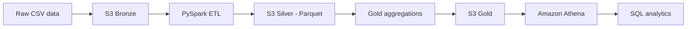

# AWS PySpark Data Lake

A data lake project based on the **Medallion Architecture (Bronze → Silver → Gold)** using Amazon S3, PySpark, Parquet, and Amazon Athena.

> **Project status:** This repository is initialized with documentation and a starter structure. Add your actual pipeline scripts, sample data, and execution evidence as they become available.

## Overview

The intended workflow ingests raw data, cleans and transforms it with PySpark, stores optimized datasets in S3, and exposes curated data for SQL analytics.

## Architecture



## Technology Stack

| Technology | Purpose |
|---|---|
| Amazon S3 | Data lake storage |
| Python | ETL scripting |
| PySpark | Data processing and transformation |
| Apache Parquet | Columnar output format |
| Amazon Athena | SQL analytics |
| Amazon EC2 | ETL compute environment, if used |
| AWS IAM | Access control |

## Medallion Layers

### Bronze — Raw
- Store ingested source files in their original format.
- Preserve raw data for traceability and reprocessing.
- Organize files with consistent S3 prefixes.

### Silver — Cleaned
- Validate and clean incoming records.
- Handle missing or inconsistent values.
- Standardize columns and data types.
- Write validated datasets in Parquet format.

### Gold — Curated
- Produce business-ready datasets and aggregations.
- Prepare metrics such as daily sales totals when supported by the source data.
- Make curated outputs available for querying.

## Suggested Repository Structure

```text
aws-pyspark-data-lake/
├── data/
│   └── README.md
├── src/
│   ├── bronze/README.md
│   ├── silver/README.md
│   └── gold/README.md
├── sql/README.md
├── docs/README.md
├── .gitignore
└── README.md
```

## Workflow

1. Upload source CSV files to the Bronze S3 location.
2. Read the raw data using PySpark.
3. Clean and validate records, then write Silver outputs in Parquet.
4. Generate curated Gold aggregations.
5. Define or update external tables in Athena.
6. Run SQL queries and validate the results.

## Setup

Exact commands depend on the AWS region, bucket names, input schema, and execution environment. Add these project-specific values before documenting runnable commands.

Prerequisites typically include:
- An AWS account and S3 bucket.
- IAM permissions for the required S3 operations.
- Python and a compatible PySpark installation.
- Athena access for SQL querying.

**Security:** Never commit AWS access keys, secret keys, `.env` files, private datasets, or other credentials. Prefer IAM roles or another secure credential provider.

## Illustrative Athena Query

Update the table and column names to match the actual Athena schema.

```sql
SELECT
    order_date,
    SUM(sales_amount) AS total_sales
FROM gold_sales
GROUP BY order_date
ORDER BY order_date;
```

## Validation Checklist

- [ ] Raw input files are present in the Bronze S3 location.
- [ ] Silver transformations handle missing and inconsistent values.
- [ ] Parquet outputs can be read successfully.
- [ ] Gold aggregations reconcile with cleaned source data.
- [ ] Athena tables point to the correct S3 locations.
- [ ] SQL query results have been validated.

## Potential Improvements

- Add automated data-quality checks.
- Orchestrate the pipeline with Apache Airflow.
- Add structured logging and error handling.
- Include screenshots and sample query outputs as execution evidence.

## Author

**Athish M.A.**  
GitHub: [@athish202403-hue](https://github.com/athish202403-hue)
